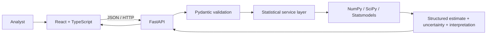

# Architecture

## Design rules
- Keep API routes thin; computations live in testable service functions.
- Validate both request shape and domain constraints.
- Return effects, uncertainty, sample sizes, method and cautious interpretation.
- Keep synthetic generation deterministic with an explicit seed.
- Do not advertise a method as implemented until estimator, diagnostics and tests exist.
- Initial API does not persist uploaded data.

For a production deployment, configure allowed CORS origins, bounded request sizes/time, observability, dependency locking and a data-retention policy.
